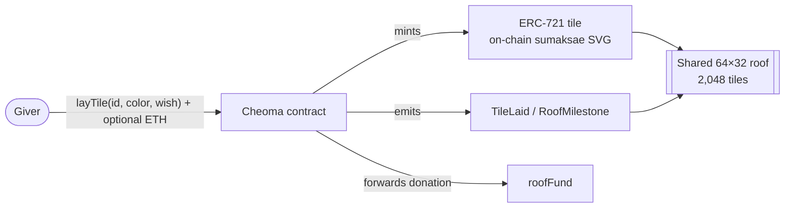

# 처마 CHEOMA

> **Lay a tile. Make a wish. Raise the roof — together.**

*English | [Türkçe](README.tr.md)*

[-1fb6a3)](https://sepolia-explorer.giwa.io)
[](https://sepolia-explorer.giwa.io/address/0xc62a7cb1afbde2f2c84febd4d35fa0e023faec2e)
[](LICENSE)
[](https://izzetcakmak.github.io/cheoma/)

---

## What is CHEOMA

At Korean Buddhist temples there is a centuries-old tradition called **giwa-bulsa (기와불사)**: before a new hall is built, visitors donate its roof tiles one by one, inking a wish or the name of a loved one onto the clay. The tiles are then laid on the roof, and every wish becomes a permanent, invisible part of the building that shelters everyone beneath it. One tile is fragile; together they make a roof.

**CHEOMA** (처마, the graceful eaves of a hanok roof) brings that tradition on-chain. Anyone can claim a tile on a shared 64×32 roof of 2,048 tiles, pick a glaze color, and inscribe a wish of up to 140 bytes. Each tile is a fully on-chain ERC-721 — the artwork, a **sumaksae (수막새)** round tile end-cap with 6–8 petals in the giver's glaze, and all metadata are generated inside the contract. No IPFS, no servers, no dependencies. The wish outlives everything else.

## Live links

| | |
|---|---|
| **dApp** | https://izzetcakmak.github.io/cheoma/ |
| **Contract (verified)** | [`0xc62a7cb1afbde2f2c84febd4d35fa0e023faec2e`](https://sepolia-explorer.giwa.io/address/0xc62a7cb1afbde2f2c84febd4d35fa0e023faec2e) |
| **Explorer** | https://sepolia-explorer.giwa.io |
| **RPC** | `https://sepolia-rpc.giwa.io` (chainId `91342`) |
| **Flashblocks RPC** | `https://sepolia-rpc-flashblocks.giwa.io` (~200ms preconfirmations via `pending`) |
| **Pitch deck / One-pager / Team** | [deck](https://izzetcakmak.github.io/cheoma/deck.html) · [one-pager](https://izzetcakmak.github.io/cheoma/onepager.html) · [team](https://izzetcakmak.github.io/cheoma/team.html) |
| **Docs** | [How to play, rules, contract reference, developer guide](https://cheoma.vercel.app/docs.html) |

## Why GIWA

1. **Cultural DNA.** GIWA is literally named after the roof tile. A communal wish-tile roof is the chain's own metaphor turned into a product — CHEOMA could not be more native anywhere else.
2. **Speed makes it possible.** 1-second blocks plus Flashblocks (~200ms preconfirmations) make laying a tile feel instant. A shared communal canvas is unusable on a 12-second chain; on GIWA it feels like touching clay.
3. **Consumer-simple.** Pick a spot, pick a color, write a wish, sign once. The mechanics fit GIWA Wallet placement perfectly — no DeFi vocabulary required.
4. **Sustainable public-goods loop.** The roadmap uses Dojang (EAS attestations) for verified givers, and paid mainnet tiles route donations to Korean public goods and ecosystem grants — real giwa-bulsa, on-chain.

## How it works

- **2,048 tiles** on a shared 64×32 roof (`id = y * 64 + x`)
- **One giver per tile** — first come, first laid; original giver is recorded forever, even if the NFT is transferred
- **Wish ≤ 140 bytes**, inscribed permanently in contract storage
- **Glaze color** — any 24-bit RGB, rendered into the on-chain sumaksae SVG
- **Max 16 tiles per wallet** — the roof is communal by design
- **Optional ETH donation** attached to `layTile`, forwarded untouched to a public `roofFund` address
- **`RoofMilestone` event every 256 tiles** — the community watches the roof rise
- **Fully on-chain art & metadata** — base64 JSON + SVG generated by the contract, no IPFS



## Architecture

**Contract — [`src/Cheoma.sol`](src/Cheoma.sol)**
- Single file, **zero external dependencies** — no OpenZeppelin, no libraries
- Minimal hand-rolled ERC-721 (ERC-165 / ERC-721 / ERC-721-Metadata)
- `tokenURI` returns base64 JSON with an embedded base64 SVG, all assembled on-chain (assembly base64 encoder, JSON-escaped wishes)
- Deterministic art: petal count (6–8) seeded from `keccak256(id, giver)`
- Donations forwarded in the same transaction; no funds ever sit in the contract
- Gas: **~160k per `layTile`** — a few cents even on L1 pricing, near-free on GIWA

**Frontend — `docs/`**
- One static HTML file + ethers v6 from CDN — **no backend, no build step**
- Reads the whole roof with paged `getRange` calls; listens to `TileLaid` for live updates
- Served by GitHub Pages; works with any injected wallet (GIWA Wallet-ready)

## Local development

Requires [Foundry](https://book.getfoundry.sh/).

```bash
git clone https://github.com/izzetcakmak/cheoma
cd cheoma

# run tests
forge test -vv

# deploy to GIWA Sepolia
export PRIVATE_KEY=0x...            # deployer key
export ROOF_FUND=0x...              # optional, defaults to deployer
forge script script/Deploy.s.sol --rpc-url https://sepolia-rpc.giwa.io --broadcast

# verify on the GIWA explorer (Blockscout)
forge verify-contract <DEPLOYED_ADDRESS> src/Cheoma.sol:Cheoma \
  --verifier blockscout \
  --verifier-url https://sepolia-explorer.giwa.io/api \
  --chain-id 91342 \
  --constructor-args $(cast abi-encode "constructor(address)" $ROOF_FUND)
```

## Roadmap

| Phase | What |
|---|---|
| **Now** | Testnet MVP live on GIWA Sepolia — verified contract, live dApp |
| **Q3 2026** | GIWA Wallet mini-app · Dojang (EAS) verified-giver badges · Korean temple & brand collab pilots — a donated on-chain tile mirrors a physical giwa-bulsa tile |
| **Mainnet** | Paid donation tiles — small protocol fee on donations, collab roofs for brands/communities, seasonal themed roofs; donations fund Korean public goods & ecosystem grants |
| **Beyond** | Multi-roof platform — any community can raise its own roof |

## Team

Solo-built by **Izzet Cakmak** — shipper of fully on-chain NFT collections (Hoodlings, 4,663 on-chain generatives on Robinhood Chain mainnet), explorers, launchpads and consumer dApps. Full track record: [team page](https://izzetcakmak.github.io/cheoma/team.html) · [GitHub](https://github.com/izzetcakmak) · [X @izzetcakmak35](https://x.com/izzetcakmak35)

## License

[MIT](LICENSE) © 2026 Izzet Cakmak

---

*기와 한 장, 소원 하나. — One tile, one wish.*
