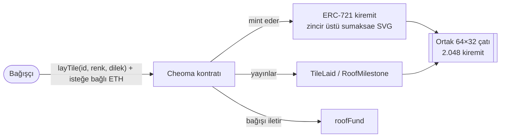

# 처마 CHEOMA

> **Bir kiremit koy. Bir dilek tut. Çatıyı birlikte yükselt.**

*[English](README.md) | Türkçe*

[-1fb6a3)](https://sepolia-explorer.giwa.io)
[](https://sepolia-explorer.giwa.io/address/0xc62a7cb1afbde2f2c84febd4d35fa0e023faec2e)
[](LICENSE)
[](https://izzetcakmak.github.io/cheoma/)

---

## CHEOMA nedir

Kore'deki Budist tapınaklarında yüzyıllardır süren bir gelenek vardır: **giwa-bulsa (기와불사)**. Yeni bir salon inşa edilmeden önce ziyaretçiler çatı kiremitlerini tek tek bağışlar; kilin üzerine bir dileği ya da sevdikleri birinin adını mürekkeple yazarlar. Kiremitler sonra çatıya dizilir ve her dilek, altındaki herkesi koruyan yapının kalıcı, görünmez bir parçası olur. Tek kiremit kırılgandır; birlikte bir çatı olurlar.

**CHEOMA** (처마, hanok çatısının zarif saçağı) bu geleneği zincir üstüne taşıyor. Herkes 2.048 kiremitlik ortak bir 64×32 çatıda bir kiremit sahiplenebilir, bir sır rengi seçebilir ve en fazla 140 baytlık bir dilek yazabilir. Her kiremit tamamen zincir üstü bir ERC-721'dir — sanat eseri, yani bağışçının sır renginde 6–8 taç yapraklı yuvarlak bir **sumaksae (수막새)** kiremit başlığı, ve tüm metadata kontratın içinde üretilir. IPFS yok, sunucu yok, bağımlılık yok. Dilek her şeyden uzun yaşar.

## Canlı bağlantılar

| | |
|---|---|
| **dApp** | https://izzetcakmak.github.io/cheoma/ |
| **Kontrat (doğrulanmış)** | [`0xc62a7cb1afbde2f2c84febd4d35fa0e023faec2e`](https://sepolia-explorer.giwa.io/address/0xc62a7cb1afbde2f2c84febd4d35fa0e023faec2e) |
| **Explorer** | https://sepolia-explorer.giwa.io |
| **RPC** | `https://sepolia-rpc.giwa.io` (chainId `91342`) |
| **Flashblocks RPC** | `https://sepolia-rpc-flashblocks.giwa.io` (`pending` etiketiyle ~200ms ön-onay) |
| **Sunum / Tek sayfa / Ekip** | [deck](https://izzetcakmak.github.io/cheoma/deck.html) · [one-pager](https://izzetcakmak.github.io/cheoma/onepager.html) · [team](https://izzetcakmak.github.io/cheoma/team.html) |

## Neden GIWA

1. **Kültürel DNA.** GIWA, adını doğrudan çatı kiremitinden alır. Ortak bir dilek-kiremiti çatısı, zincirin kendi metaforunun ürüne dönüşmüş hâlidir — CHEOMA başka hiçbir yerde bu kadar yerli olamazdı.
2. **Hızı mümkün kılıyor.** 1 saniyelik bloklar ve Flashblocks (~200ms ön-onay) kiremit koymayı anlık hissettiriyor. Ortak bir tuval 12 saniyelik bir zincirde kullanılamaz; GIWA'da kile dokunmak gibi.
3. **Tüketici kadar basit.** Bir yer seç, bir renk seç, bir dilek yaz, bir kez imzala. Mekanikler GIWA Wallet yerleşimine kusursuz uyar — DeFi jargonu gerekmez.
4. **Sürdürülebilir kamu yararı döngüsü.** Yol haritası, doğrulanmış bağışçılar için Dojang (EAS attestation) kullanıyor; ücretli mainnet kiremitleri bağışları Kore kamu yararı projelerine ve ekosistem hibelerine yönlendiriyor — gerçek giwa-bulsa, zincir üstünde.

## Nasıl çalışır

- Ortak 64×32 çatıda **2.048 kiremit** (`id = y * 64 + x`)
- **Kiremit başına tek bağışçı** — ilk gelen koyar; NFT devredilse bile ilk bağışçı sonsuza dek kayıtlı kalır
- **Dilek ≤ 140 bayt**, kontrat depolamasına kalıcı olarak işlenir
- **Sır rengi** — herhangi bir 24-bit RGB, zincir üstü sumaksae SVG'sine işlenir
- **Cüzdan başına en fazla 16 kiremit** — çatı tasarımı gereği ortaktır
- `layTile` çağrısına eklenen **isteğe bağlı ETH bağışı**, olduğu gibi herkese açık `roofFund` adresine iletilir
- **Her 256 kiremitte bir `RoofMilestone` olayı** — topluluk çatının yükselişini izler
- **Tamamen zincir üstü sanat ve metadata** — base64 JSON + SVG kontrat tarafından üretilir, IPFS yok



## Mimari

**Kontrat — [`src/Cheoma.sol`](src/Cheoma.sol)**
- Tek dosya, **sıfır harici bağımlılık** — OpenZeppelin yok, kütüphane yok
- Elle yazılmış minimal ERC-721 (ERC-165 / ERC-721 / ERC-721-Metadata)
- `tokenURI`, içine base64 SVG gömülü base64 JSON döndürür; tamamı zincir üstünde birleştirilir (assembly base64 kodlayıcı, JSON'a uygun kaçışlanan dilekler)
- Deterministik sanat: taç yaprak sayısı (6–8) `keccak256(id, giver)` tohumundan gelir
- Bağışlar aynı işlem içinde iletilir; kontratta hiçbir zaman fon birikmez
- Gaz: **`layTile` başına ~160k** — L1 fiyatlarıyla bile birkaç sent, GIWA'da neredeyse bedava

**Frontend — `docs/`**
- Tek statik HTML dosyası + CDN'den ethers v6 — **backend yok, build adımı yok**
- Çatının tamamını sayfalı `getRange` çağrılarıyla okur; canlı güncellemeler için `TileLaid` olayını dinler
- GitHub Pages üzerinden sunulur; herhangi bir enjekte cüzdanla çalışır (GIWA Wallet'a hazır)

## Yerel geliştirme

[Foundry](https://book.getfoundry.sh/) gerekir.

```bash
git clone https://github.com/izzetcakmak/cheoma
cd cheoma

# testleri çalıştır
forge test -vv

# GIWA Sepolia'ya deploy et
export PRIVATE_KEY=0x...            # deployer anahtarı
export ROOF_FUND=0x...              # isteğe bağlı, varsayılanı deployer
forge script script/Deploy.s.sol --rpc-url https://sepolia-rpc.giwa.io --broadcast

# GIWA explorer'da doğrula (Blockscout)
forge verify-contract <DEPLOY_ADRESI> src/Cheoma.sol:Cheoma \
  --verifier blockscout \
  --verifier-url https://sepolia-explorer.giwa.io/api \
  --chain-id 91342 \
  --constructor-args $(cast abi-encode "constructor(address)" $ROOF_FUND)
```

## Yol haritası

| Aşama | Ne |
|---|---|
| **Şimdi** | Testnet MVP GIWA Sepolia'da canlı — doğrulanmış kontrat, canlı dApp |
| **2026 Q3** | GIWA Wallet mini-app · Dojang (EAS) doğrulanmış bağışçı rozetleri · Kore tapınağı ve marka iş birliği pilotları — bağışlanan zincir üstü kiremit, fiziksel giwa-bulsa kiremitini yansıtır |
| **Mainnet** | Ücretli bağış kiremitleri — bağışlardan küçük protokol ücreti, markalar/topluluklar için iş birliği çatıları, sezonluk temalı çatılar; bağışlar Kore kamu yararı projelerini ve ekosistem hibelerini fonlar |
| **Sonrası** | Çoklu çatı platformu — her topluluk kendi çatısını yükseltebilir |

## Ekip

**Izzet Cakmak** tarafından tek başına geliştirildi — tamamen zincir üstü NFT koleksiyonları (Hoodlings, Robinhood Chain mainnet'te 4.663 zincir üstü generative NFT), explorer'lar, launchpad'ler ve tüketici dApp'leri geliştiricisi. Tam geçmiş: [ekip sayfası](https://izzetcakmak.github.io/cheoma/team.html) · [GitHub](https://github.com/izzetcakmak) · [X @izzetcakmak35](https://x.com/izzetcakmak35)

## Lisans

[MIT](LICENSE) © 2026 Izzet Cakmak

---

*기와 한 장, 소원 하나. — Bir kiremit, bir dilek.*
